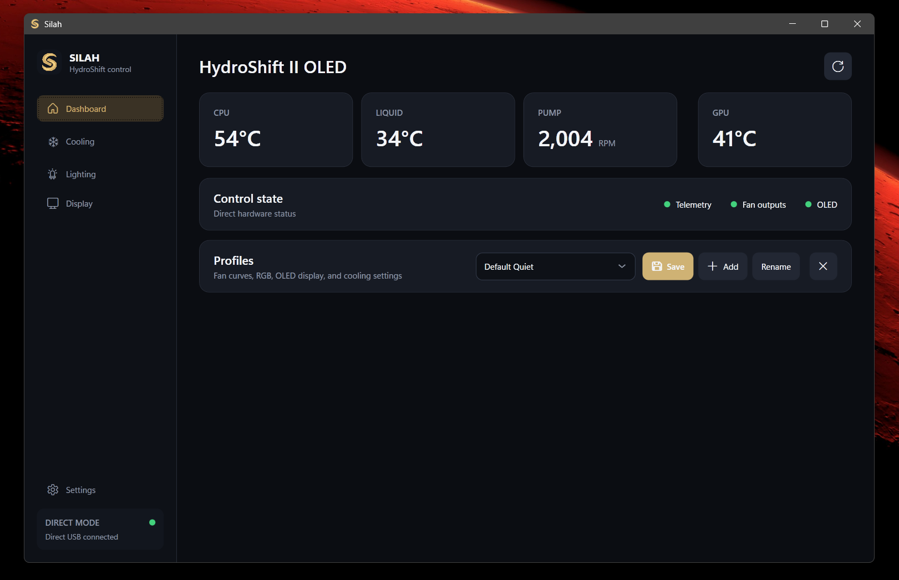
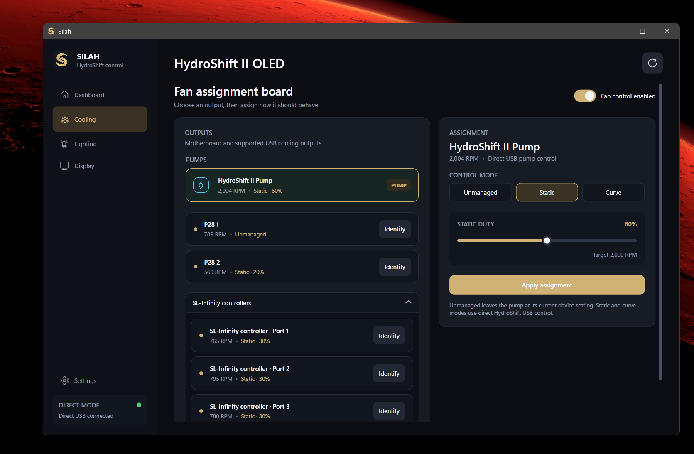
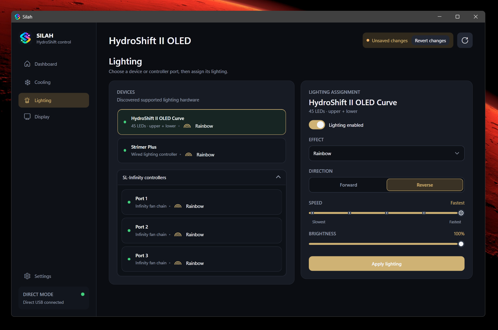
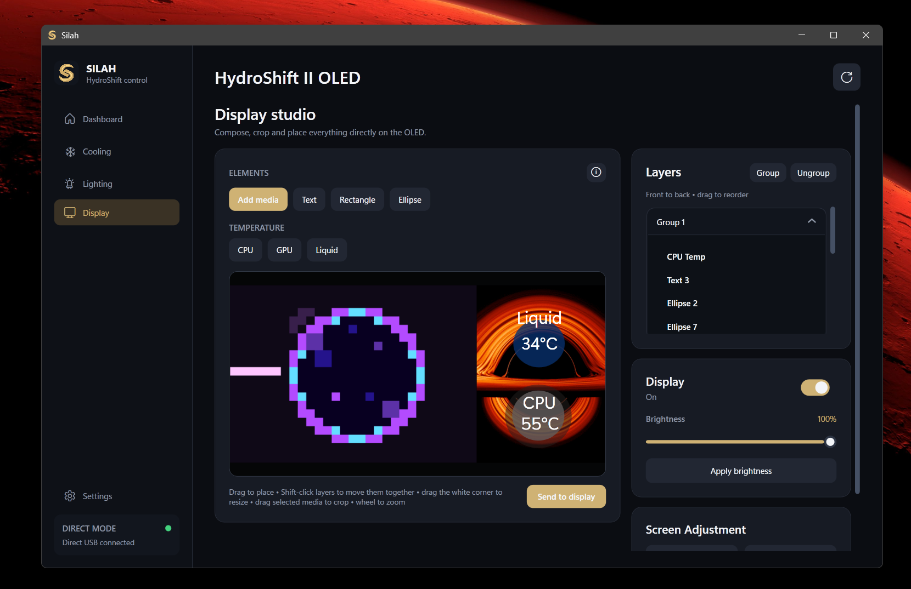

# Silah

A lightweight, native Windows controller for the **Lian Li HydroShift II OLED Curved 360P28**. Silah replaces the parts of L-Connect needed for cooling, lighting, profiles, and the OLED display without embedding a browser or requiring a cloud account.

> [!WARNING]
> Silah is experimental hardware-control software. Test fan assignments carefully and keep safe firmware or BIOS limits configured. Firmware updates are intentionally unsupported.

## Features

- Direct control of the HydroShift II pump, OLED, LEDs, and motorized screen mount
- CPU, GPU, liquid-temperature, pump, and fan telemetry
- Static or temperature-driven cooling using CPU, GPU, or liquid temperature
- Runtime fan/controller discovery with identification, aliases, and controller-wide assignment
- UNI FAN SL-Infinity controller and HydroShift P28 pump/fan control
- Lighting effects, direction, speed, and brightness controls
- Display Studio with images, GIFs, video, SVG, fonts, shapes, live temperature and clock layers, groups, cropping, snapping, drag-and-drop ordering, and undo
- Display power, brightness, angle, and height controls
- Complete profiles covering cooling, lighting, and OLED layouts
- Start with Windows and optional L-Connect startup disablement
- Single-instance native Windows application with no telemetry, account, cloud service, or background browser

## Screenshots

### Cooling

### Lighting

### Display Studio

## Supported hardware

| Hardware | USB ID | Support |
|---|---:|---|
| HydroShift II OLED Curved display | `1CBE:A068` | Display, media streaming, brightness, LEDs, and screen adjustment |
| HydroShift II pump/controller | `0416:8051` | Pump, liquid temperature, and direct pump control |
| UNI FAN SL-Infinity controller | `0CF2:A102` | Per-port RPM, duty, identification, and lighting |
| Motherboard fan outputs | Discovered at runtime | RPM monitoring and supported writable PWM channels |

Hardware discovery is runtime-based; fan header numbers, names, and controller layouts are not hardcoded to one PC. Other Lian Li devices should be considered untested unless listed above.

## Download and run

1. Open the [latest release](../../releases/latest).
2. Download `Silah.exe`.
3. Run `Silah.exe` and approve Windows' administrator prompt. If the PawnIO sensor driver is missing, Silah offers its bundled official installer; installation is optional and requires consent.
4. Open **Settings** and confirm the required devices show as connected.
5. If L-Connect is installed, use Silah's **Disable L-Connect on startup** option or stop L-Connect before claiming the same USB devices.
6. In **Cooling**, identify each output before enabling control.

Silah stores settings locally in `%LOCALAPPDATA%\Silah`. Administrator access may be required for motherboard fan-control interfaces. L-Connect and Silah cannot simultaneously own the same exclusive USB interface.

### Dependencies — included, not separate downloads

`Silah.exe` includes the **.NET 8 runtime, FFmpeg media encoder, USB libraries, and official PawnIO installer**. You do not need to install .NET, FFmpeg, or L-Connect separately. PawnIO is a **signed kernel driver** required for CPU/motherboard sensors and is installed only after you agree. See [Dependencies and first launch](DEPENDENCIES.md) for the complete dependency list and requirements, and [third-party notices](THIRD_PARTY_NOTICES.md) for licenses/source archives.

## Project status

### Latest update: v0.2.5

- Lower GIF/video composition memory usage by cropping before scaling.
- Improved OLED stream recovery and command acknowledgement handling.
- Stable live telemetry text updates and improved text/clock resizing.
- Bundled offline media encoding and optional, consent-based PawnIO setup inside a single executable.
- Bundled media tools take priority over pre-existing external FFmpeg/L-Connect copies.
- Validated with 67 automated tests and an isolated single-executable packaging check (empty PATH). Previous monitor-off/on playback check passed; long-duration stability remains under investigation.

Extended overnight stability and the reported coolant-sensor issue remain under investigation.

Silah is currently closed-source while hardware support and safety behavior mature. Please use this repository for releases, documentation, bug reports, and feature requests.

Silah is an independent community project and is not affiliated with or endorsed by Lian Li.
